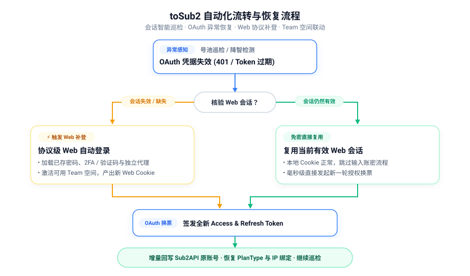

# sub2api helper

感谢原项目 [poxiao33/toSub2](https://github.com/poxiao33/toSub2) 的开源贡献，本项目在其基础上持续改进。

**把 ChatGPT Web 登录、Codex OAuth 授权与 Sub2API 号池维护串成可持续运行的工作流。**

sub2api helper 提供网页控制台与协议级登录工具：覆盖批量账号导入、登录质检、工作空间切换、授权文件生成上传，以及会话巡检、异常自动恢复、套餐与代理联动等全流程维护。

**新账号首次导入默认仅登录 Web**，识别 PlanType 后按“任务设置”的对应规则选择 Codex 授权、上传和自动监控；未匹配规则时不自动申请 OAuth。

[功能概览](#功能概览) · [自动化能力](#自动化能力) · [任务设置](#任务设置) · [快速开始](#快速开始) · [使用与配置指南](docs/usage-guide.md)

## 功能概览

| 模块 | 支持能力 |
| --- | --- |
| **登录与授权** | 密码或邮箱验证码登录、邮箱 API 自动收码、TOTP 2FA；复用有效 Web 会话，完成 Codex OAuth 并生成 `sub2api-data` 文件。 |
| **手机号验证** | 自动识别手机号绑定要求，支持手动验证、LubanSMS、SMSBower 与自定义接码 API；SMSBower 支持余额查询、USD 价格上限、指定/不限国家选号、库存预估、虚拟号过滤、失败号池避让及 Gold → Silver → Bronze 优先取号。 |
| **批量账号管理** | 分页、筛选、跨页多选、批量检测／授权／上传／下载；任务排队、进度展示、日志流与最近操作详情。 |
| **设备与工作空间** | 查看已登录设备、管理会话、切换空间；登录优先激活可用 Team 空间，支持个人空间。 |
| **套餐与代理方案** | 依据当前 Web 空间确认 PlanType，联动直连、固定代理或均衡分配方案；套餐变化后自动核对绑定。 |
| **号池增量维护** | 管理启用状态、分组、备注、优先级与方案配置；精准更新已有号池记录与绑定。 |
| **用量与费用统计** | 展示窗口额度、重置卡，以及去重汇总的 `A` 账号消耗、`U` 用户收费、`T` Token 总量。 |
| **凭据与 2FA 管理** | 安全查看与更新密码、轮换 12 位随机密码、创建或轮换 2FA；密码与 2FA 历史全部保留，会话类凭据仅保留当前版本。 |
| **Codex 状态面板** | 整合过载监测、自动冷却、降智检测、请求趋势折线图与能量条。 |

接码选价规则与 OAuth 手机验证流程见 [SMSBower 接码说明](docs/smsbower-oauth-flow.md)。

## 自动化能力

自动任务由**服务端**后台自驱运行，关闭浏览器后仍持续调度。

### 自动化流转流程

<div align="center">
  
</div>

<table width="100%">
  <thead>
    <tr>
      <th width="30%">1. 异常感知与触发</th>
      <th width="40%">2. 会话核验与自动补登</th>
      <th width="30%">3. 授权换票与号池同步</th>
    </tr>
  </thead>
  <tbody>
    <tr>
      <td valign="top">
        <b>OAuth 凭据失效</b><br/>
        • 号池巡检返回 <code>401</code> / <code>token_expired</code><br/>
        • 降智采样挑战捕获凭据失效<br/>
        • 或 Web 定时测活发现 Cookie 失效
      </td>
      <td valign="top">
        <b>核验 Web 会话可用性：</b><br/><br/>
        🟢 <b>会话有效</b> ➔ 免密直接复用，秒级换票<br/><br/>
        🟡 <b>会话失效</b> ➔ <b>【自动触发 Web 补登】</b><br/>
        • 自动加载账密、2FA / 验证码与独立代理<br/>
        • 完成 Web 协议登录，优先激活 <b>Team</b> 空间<br/>
        • 产出全新有效 Web Session Cookie
      </td>
      <td valign="top">
        <b>Codex 授权与号池回写：</b><br/>
        • 使用新会话完成 Codex OAuth 换票<br/>
        • 增量更新 Sub2API 原账号记录<br/>
        • 恢复 PlanType 映射与 IP 绑定
      </td>
    </tr>
  </tbody>
</table>

### 支持的自动化功能

| 功能 | 触发方式 | 执行内容 |
| --- | --- | --- |
| **Web 会话巡检** | 定时扫描 (默认 15m) | Cookie 实际测活，失效时自动触发 Web 补登。 |
| **OAuth 异常恢复** | 凭据失效 (401 / 过期) | 优先复用有效 Web 会话；会话失效联动触发 Web 补登并恢复 OAuth。 |
| **Web 协议补登** | 会话失效或授权修复 | 自动读取账密、2FA 密钥或验证码完成登录，优先激活 Team 空间。 |
| **空间与套餐同步** | 登录确认或会话巡检 | 读取空间列表并激活 Team 空间，随套餐变化联动切换代理方案。 |
| **过载自动冷却** | 当前 15m 格 ≥ 10 次，或图表 90m 累计 ≥ 30 次 | 任一满足就暂停号池调度 60 分钟，到期自愈唤醒恢复。 |
| **会话重建** | 操作列手动执行；冷却后自动执行可选，默认关闭 | 登出所有设备 → 重登 Web → Codex OAuth → 原位更新号池凭据；原 IP 绑定保持不变。 |
| **降智检测** | 定时采样 (默认 360m) | 支持模型指纹、糖果单题及双向轮换（如指纹 1 次 → 糖果 N 次），各账号独立保存轮换进度；保留最近 6 轮 prompt、回答、重试、Token 与耗时，展开时按需读取。通过添加 PlanType 启用自动检测；可按检测结果管理条件分组，同时为通过的账号设置独立号池并发。 |
| **封禁联动防御** | 账号确认封禁 | 停用号池账号并解绑代理 IP，防止代理池污染。 |
| **累计用量同步** | 定时调度 (默认 60s) | 同步总消耗、实际费用与 Token (A/U/T)，去重汇总展示。 |

## 任务设置

顶部“任务设置”集中管理调度参数，保存到服务端，重启后保留。

| 调度项 | 默认值 | 说明 |
| --- | --- | --- |
| 登录、OAuth 与 Web 测活 | 共用 **4** 个任务槽位 | 可设 1–20 并发，满额自动排队。 |
| Web 会话检测／重登重试 | **15 分钟／60 分钟** | 巡检默认关闭；调度器每 30 秒扫描到期账号。 |
| 号池状态／累计用量同步 | **15 秒／60 秒** | 服务端独立调度，额度读取号池快照。 |
| 号池异常恢复／授权失败重试 | **跟随状态刷新／5 分钟** | 启用后，每次完整状态刷新发现可恢复错误即加入授权队列。 |
| 过载统计／冷却到期恢复 | **60 秒同步／独立截止时间** | 当前固定格达到阈值，或图表累计达到 3 倍阈值，就冷却；到期唤醒恢复。 |
| 降智检测 | **360 分钟、3 个账号并发** | 默认关闭，支持 1–16 个独立账号队列。 |
| 纯号池网络同步 | 各类默认 **100** 并发 | 用量、配置、过载统计及冷却分别可调。 |

## 快速开始

环境要求：**Node.js 22+、Python 3.9+**；协议请求依赖 `curl_cffi`。

```bash
git clone https://github.com/li-zane/sub2api-helper.git
cd sub2api-helper
npm install
python -m pip install -r requirements.txt
npm run dev
```

打开 [http://127.0.0.1:4399](http://127.0.0.1:4399)，配置登录／邮箱／代理与 Sub2API，即可按需开启自动任务。

## 文档导航

- [使用与配置指南](docs/usage-guide.md)：安装、部署、代理、登录资料、接码、上传与输出文件。
- [自动化与任务设置](docs/automation.md)：触发条件、恢复规则、并发与检测间隔。
- [Web 会话巡检](docs/web-session-monitor.md)：测活、补登、空间变化及主动暂停。
- [账号登录操作](docs/account-login-actions.md)：Web 会话检测、统一 Codex 授权及一键轮换的执行顺序。
- [用量同步](docs/account-usage-sync.md)：窗口额度、A/U/T 的来源与统计口径。
- [UI 回归测试](docs/ui-regression-tests.md) · [更新日志](CHANGELOG.md)

## 开源许可

本项目与 OpenAI 无隶属关系。开源许可：[MIT](LICENSE)。
