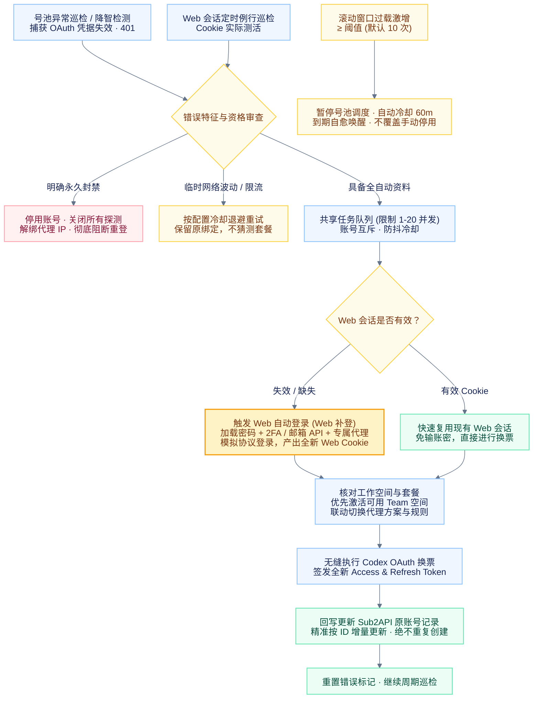

# 自动化与任务设置

[返回功能介绍](../README.md) · [查看交互式全景 HTML 流程图](automation-flow.html) · [使用与配置](usage-guide.md)

本文按当前仓库实现整理。各项默认值只用于首次配置或恢复默认，不覆盖服务器已保存的值；账号级覆盖、任务是否启用以及自动登录资格仍会影响执行。

## 自动维护与恢复流程

以下流程针对巡检发现的异常或身份变化，不表示每次健康检查都会重新登录或授权。支持在浏览器打开 [automation-flow.html](automation-flow.html) 查看动态交互式流程图。

- **OAuth 凭据失效联动 Web 补登**：当号池巡检或降智检测捕获 401 / Token 过期，系统首先判定 Web 会话可用性。若 Web 会话已失效，**自动联动触发 Web 补登**（读取已保存密码、2FA 密钥或邮箱 API，经由专属代理完成浏览器协议登录并优先切换至可用 Team 空间）；取得全新 Web 会话后，立即无缝驱动 Codex OAuth 换票并增量回写至 Sub2API 已有账号。
- **Web 会话有效时免输密复用**：若 Web 会话仍然有效，则直接复用 Web Cookie 签发 OAuth，毫秒级换票，不发起冗余的完整登录。
- **Web 巡检与号池巡检隔离互斥**：Web 巡检、号池异常巡检与降智检测是不同入口，通过账号级互斥锁和修复冷却避免并发冲突或重复授权。
- **精准增量回写，绝不乱建号**：自动修复只对 Sub2API 原账号 ID 发送 PUT 更新，保留原有配额和历史统计；上传临时失败优先重试重传，绝不推倒重复登录。
- **手机号、验证码等人工卡点安全挂起**：需要手机号接码、交互式验证码或其它人工处理时，任务在控制台清晰保留等待状态，不盲目乱试。

## 持续运行的任务

| 任务 | 读取或执行内容 | 后续处理 |
| --- | --- | --- |
| Web 会话巡检 | 使用保存的 Cookie 请求 `/api/auth/session`，读取工作空间与设备。 | 更新快照与套餐；确认会话／空间问题后进入共享恢复队列。 |
| 号池状态同步 | 读取 Sub2API 账号状态和窗口额度快照。 | 反映启用状态、套餐与封禁证据；不主动请求上游额度接口。 |
| 累计用量同步 | 读取账号所有留存历史的 `total_account_cost`、`total_actual_cost`、`total_tokens`。 | 同邮箱 OAuth ID 去重汇总为 A/U/T；后台更新，失败保留旧值。 |
| 号池异常巡检 | 按配置范围检查号池错误记录及套餐变化。 | 自动登录资料可恢复且无冲突时重新授权；更新已有记录，失败按冷却重试。 |
| 过载统计 | 读取过载错误日志，以及成功／失败请求记录。 | 两条独立缩放的曲线保留六个完整的 15 分钟区间，显示原始计数。 |
| 过载冷却 | 检查滚动时间窗中的过载次数。 | 达到阈值暂停调度，到期恢复；用户手动停用优先。 |
| 降智检测 | 用账号实际凭据和绑定代理发送指纹或糖果挑战，按设置轮换并本地评分。 | 按最近一轮结果维护“不降智加入”条件分组，任一种方法通过即可加入，明确未通过则移出，未知／错误保留已有分组；明确授权失效触发修复。 |
| 封禁处理 | 识别明确账号封禁或永久停用证据。 | 关闭相关开关、取消授权／探测、停用号池、解除 IP 绑定；保留最小状态读取和解绑重试。 |

降智检测不是通过号池的均衡请求路径发起，直接采样会消耗账号额度，但不会计入 Sub2API 的 A/U/T 用量计费链路。指纹判定是参考库内的统计归因，不是模型身份或智力证明。

## 任务设置与默认值

设置入口为控制台顶部 **任务设置**。参数保存到服务端；保存后重新安排调度，重启后恢复。调低并发不强行中断已在途请求，新排队请求遵守新上限。

### 登录、Web 与降智

| 设置 | 代码默认值 | 范围／用途 |
| --- | --- | --- |
| `maxActiveJobs` | 4 | 1–20；登录、OAuth 与 Web 测活共用，不限制所有其它后台请求。 |
| `webSessionMonitor.enabled` | 关闭 | 定时 Web 维护需显式开启。 |
| `webSessionMonitor.intervalMinutes` | 15 分钟 | 1–1440；账号检测间隔。 |
| `webSessionMonitor.retryMinutes` | 60 分钟 | 15–1440；同账号自动重登冷却。 |
| `webSessionMonitor.autoRelogin` | 开启 | 仅在定时巡检已启用时生效；关闭后只检测不补登。 |
| `modelFingerprint.intervalMinutes` | 360 分钟 | 5–43200；降智默认间隔。 |
| `modelFingerprint.maxConcurrentAccounts` | 3 | 1–16；独立账号队列，不共用登录槽位。 |

降智默认关闭且模型列表为空。检测间隔、并发、模型、概率门槛、套餐默认开关和条件分组统一在降智检测设置中管理，任务设置不重复展示，账号独立覆盖继续生效。

### 新增的监控与同步参数

| 设置（`monitoring` 下） | 名称 | 代码默认值 | 可设置范围 |
| --- | --- | --- | --- |
| `accountStatusIntervalSeconds` | 号池状态刷新间隔 | 15 秒 | 1–86400 秒 |
| `usageTotalsIntervalSeconds` | 累计用量与金额同步间隔 | 60 秒 | 1–86400 秒 |
| `usageTotalsConcurrency` | 累计用量同步并发 | 100 请求 | 1–1000 请求 |
| `profileSyncConcurrency` | 号池配置同步并发 | 100 请求 | 1–1000 请求 |
| `poolMonitorIntervalSeconds` | 号池异常巡检间隔 | 300 秒 | 1–86400 秒 |
| `poolRepairRetrySeconds` | 异常重新授权重试间隔 | 300 秒 | 0–86400 秒 |
| `overloadIntervalSeconds` | 过载统计刷新间隔 | 900 秒 | 1–86400 秒 |
| `overloadConcurrency` | 过载统计并发 | 100 请求 | 1–1000 请求 |
| `overloadCooldownIntervalSeconds` | 过载冷却检查间隔 | 60 秒 | 1–3600 秒 |
| `overloadCooldownConcurrency` | 过载冷却检查并发 | 100 请求 | 1–1000 请求 |
| `webSessionScanIntervalSeconds` | Web 巡检调度扫描间隔 | 30 秒 | 1–3600 秒 |
| `fingerprintScanIntervalSeconds` | 降智巡检调度扫描间隔 | 60 秒 | 1–3600 秒 |

- 号池状态与累计统计由服务端按各自频率同步，不依赖页面持续轮询。窗口额度仍来自号池已有快照，其上游更新时机由 Sub2API 决定。
- **扫描间隔不是账号检测间隔**：调度扫描只决定多快发现到期任务，账号业务检测周期另行配置。
- **刷新间隔不是图表统计窗口**：过载折线固定按六个完整的 15 分钟区间展示，调整刷新频率不会把 90 分钟历史改成其它口径。
- 纯号池请求按各类配置限流；登录、Web 测活、降智采样的并发不因此统一变成 100。
- 过载冷却规则另由 `overloadAutoCooldown` 配置：默认窗口 15 分钟、阈值 10 次、冷却 60 分钟。冷却到期会及时唤醒，不必等待整轮轮询。

任务设置将过载参数集中到“过载”区域，区分统计展示与自动冷却；两项网络并发在“过载并发设置”中展开。按 PlanType“自动开启过载统计”只控制账号开关，统计与冷却可独立启用。

`POST /api/task-settings` 支持局部更新，`monitoring`、`webSessionMonitor` 和 `overloadAutoCooldown` 的省略字段保留当前值，并发保存也在写入时合并。前端只提交修改过的值，普通保存不强制巡检；实际修改 Web 巡检规则或冷却规则时才唤醒对应任务。无效请求不改变已保存配置。恢复默认覆盖基础与监控参数（含接码时限、号池价格倍率），保留 PlanType 自动任务和独立降智配置，点击保存后才生效。

## 恢复资格与人工决定

号池异常自动重新授权要求上次完整登录全自动完成，且所需密码、邮箱收码 API、2FA 资料仍可用。它不会根据“账号失败”这个标签无条件尝试登录。

- **明确凭据失效**：401 或可识别的无效／过期 Token 进入授权恢复；普通 403 不等于凭据过期。
- **临时异常**：网络、限流、上游错误按各自重试／退避规则处理；Web 测活的非终态错误最多额外重试两次。
- **空间停用**：按空间错误处理，不冒充账号封禁；空间、套餐不能确认时保留诊断，不猜测 Free。
- **明确封禁**：停止该账号的授权与检测，并解绑 IP；不自动反复重登。现有凭据保留，重新确认状态由用户显式发起。
- **主动登出或取消**：持久化相应维护暂停标记；手动检测、登录或重新开始授权可按对应操作恢复维护。
- **手动停用或过载冷却**：恢复 OAuth 不无条件打开号池调度；只有原本由自动冷却暂停的记录按冷却规则恢复。

## 授权后的单次任务

任务设置可按 PlanType 配置上传、一键轮换并上传、开启过载检测或冷却。它们在符合条件的授权完成后依次执行，具有持久化进度；不是每轮巡检都重复执行的一组命令。

持续运行的开关会在确认套餐变化后重新核对：套餐不再匹配时关闭受规则管理的检测；同套餐下用户手动关闭的开关不会每轮自动打开。降智的显式账号覆盖优先于继承默认值。

## 实现与验证入口

- [共享监控字段与范围](../web/src/monitor-settings.mjs)
- [任务设置、号池同步与授权队列](../src/console-server.mjs)
- [Web 会话巡检](../src/web-session-monitor.mjs) · [会话与空间探测](../src/account-sessions.mjs)
- [过载统计](../src/overload-monitor.mjs) · [自动冷却](../src/overload-cooldown.mjs)
- [指纹检测](../src/model-fingerprint.mjs) · [累计统计](../src/sub2api-usage-totals.mjs)

相关测试：`node test/monitor-settings.mjs`、`node test/automation-recovery.mjs`、`node test/console-task-settings-smoke.mjs`、`node test/console-usage-totals-smoke.mjs`。浏览器回归见 [UI 测试说明](ui-regression-tests.md)。
